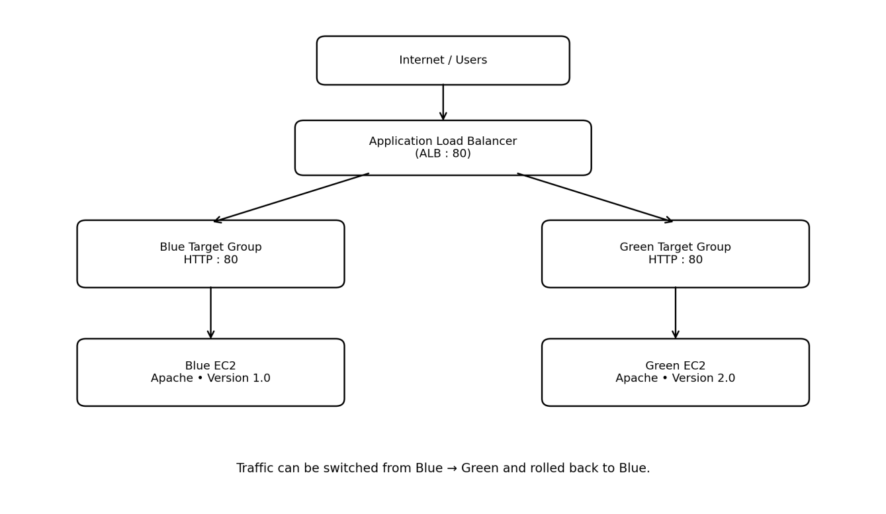
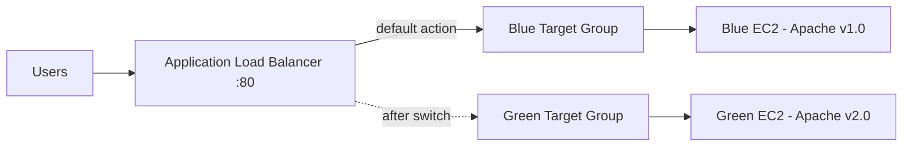

# Blue-Green Deployment on AWS

Zero-downtime release strategy using **two EC2 environments** (Blue = Version 1.0, Green = Version 2.0) behind an **Application Load Balancer**. Traffic is switched by changing the ALB listener's target group, and rolled back the same way in seconds.

## How it works

1. Blue EC2 serves **Version 1.0** and is registered in the Blue target group.
2. Green EC2 is prepared separately with **Version 2.0** and must pass health checks.
3. The ALB listener initially forwards to **Blue**.
4. After Green is verified healthy, the listener is switched to **Green**.
5. If anything fails, switch the listener back to **Blue** (rollback).

## Tech stack
Amazon EC2 (Amazon Linux 2023) | Application Load Balancer | Target Groups & health checks | VPC | Security Groups | Apache HTTP Server | HTML/CSS

## Security design
| Security group | Inbound | Source |
|---|---|---|
| `BlueGreen-ALB-SG` | TCP 80 | 0.0.0.0/0 |
| `BlueGreen-Instance-SG` | TCP 80 | ALB security group only |
| `BlueGreen-Instance-SG` | TCP 22 | My IP only |

EC2 web access is restricted to the load balancer, and SSH is limited to the administrator's IP.

## Repository contents
- `scripts/blue-user-data.sh` - EC2 user data for the Blue (v1.0) server
- `scripts/green-user-data.sh` - EC2 user data for the Green (v2.0) server
- `images/` - architecture diagram, workflow diagrams and result screenshots
- `report/Blue-Green-Deployment-Report.pdf` - full project report

## Results
| Test | Result |
|---|---|
| ALB -> Blue | Version 1.0 page served |
| ALB -> Green | Version 2.0 page served after switching the listener |
| Rollback | Switching the listener back returns Version 1.0 |

## Future improvements
- Automate releases with CodeDeploy / CodePipeline
- Launch Templates and Auto Scaling Groups
- HTTPS listener with an SSL/TLS certificate
- Weighted target groups for gradual shifts (90/10, 50/50, 0/100)
- CloudWatch monitoring and Infrastructure as Code (Terraform / CloudFormation)

> **Cost note:** delete the ALB, target groups and EC2 instances after testing to avoid AWS charges.

## Author
**Atharva Vadage** - [GitHub](https://github.com/Atharva72218)
